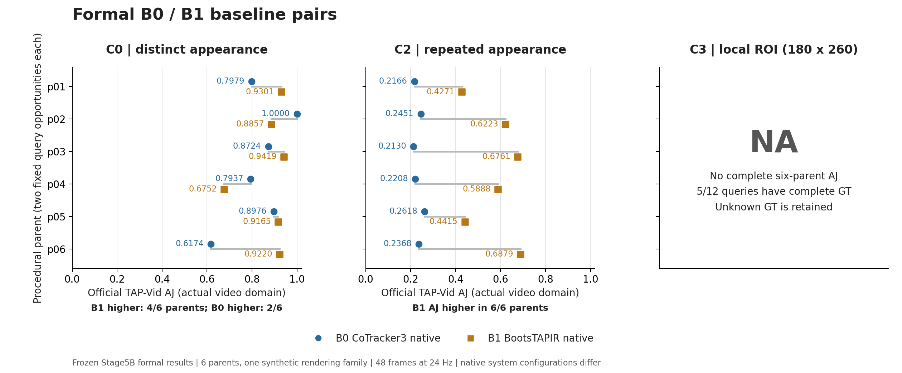
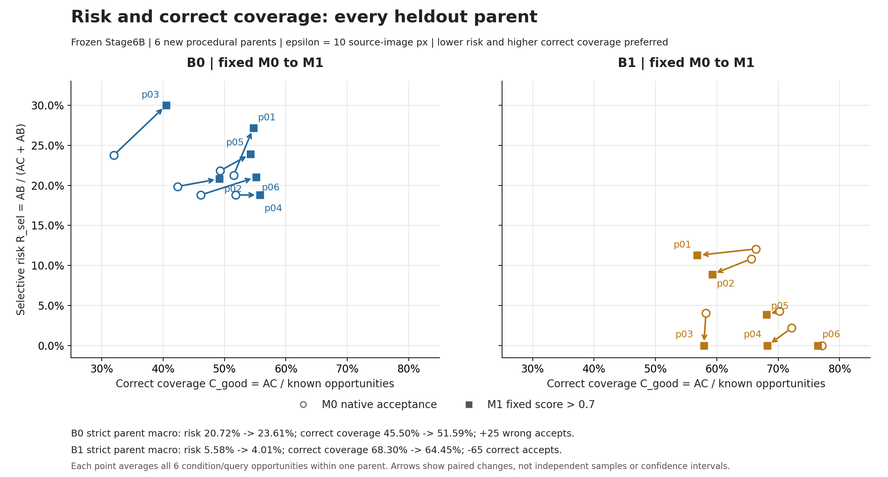
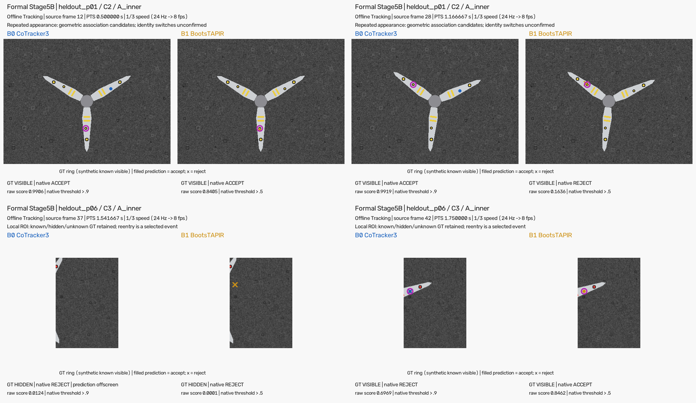

# UAVVisualTracking — Public Research Snapshot v0.1

When repeated structures leave and reenter a camera view, a plausible point track can remain confidently wrong. This research studies material-point correspondence and the tradeoff between rejecting observations and accepting geometrically correct ones.

**Offline Tracking.** B0 (CoTracker3) and B1 (BootsTAPIR) are existing baselines. M1 is a fixed score-gating operating point: it changes acceptance, never coordinates, and is not a new network. Current evidence is synthetic, from one rendering family. Real material-point GT, real turbine performance and onboard real-time operation have not been established.

## Frozen research evidence



Stage5B: six procedural parents, two fixed queries per condition, 48 frames at 24 Hz. C0 has mixed parent rankings (B1 AJ higher in 4/6, B0 in 2/6); B1 AJ is higher in 6/6 C2 parents. C3 contains unknown GT: only 5/12 queries have complete GT, so complete six-parent standard AJ, δavg and OA are **NA**. Native resolutions and support policies differ between models; these are system comparisons.



Stage6B uses six new procedural parents. At 10 source-image pixels, strict parent macro risk / correct coverage changes from **20.72% / 45.50% to 23.61% / 51.59% for B0**, and **5.58% / 68.30% to 4.01% / 64.45% for B1**. B0 gains coverage with 25 additional wrong accepts; B1 reduces risk while losing 65 correct accepts. All parent changes are shown above. These tradeoffs do not establish a universally better gate.



[Repeated appearance: p01 / C2 / A_inner](docs/assets/repeated_appearance.mp4) · [Local reentry: p06 / C3 / A_inner](docs/assets/local_reentry.mp4). Each video pairs B0/B1 on identical frozen frames and query, with material GT, native acceptance, frame number and PTS. Both show all 48 frames at one-third speed (8 fps); source time is 24 Hz. Geometric association candidates are not confirmed identity switches. No Pilot image is labeled as formal evidence.

Exact chart data: [baseline parents](results/baseline_parent.csv), [reliability parents](results/reliability_parent.csv), [frozen summaries](results/summary.json). Sources and rights: [SOURCE_MANIFEST](SOURCE_MANIFEST.json), [MEDIA_MANIFEST](docs/assets/MEDIA_MANIFEST.json). Methods and evaluation schemas: [RESEARCH_STATUS](docs/RESEARCH_STATUS.md).

## Install and obtain external models

Python 3.10 or later and Git are required. From this snapshot directory:

```sh
python -m pip install .
# Alternatively, for development:
python -m pip install -e .
```

Install a PyTorch/torchvision build suited to your CPU or CUDA environment, then `python -m pip install ".[models]"` for model adapter dependencies. No model source, weight or input video is bundled or automatically downloaded. CPU is selectable but has not been model-tested in this snapshot.

| Baseline | Official source revision | External weight |
|---|---|---|
| B0 CoTracker3 | [facebookresearch/co-tracker](https://github.com/facebookresearch/co-tracker/tree/82e02e8029753ad4ef13cf06be7f4fc5facdda4d), `82e02e8029753ad4ef13cf06be7f4fc5facdda4d` | [scaled_offline.pth](https://huggingface.co/facebook/cotracker3/blob/main/scaled_offline.pth) |
| B1 BootsTAPIR | [google-deepmind/tapnet](https://github.com/google-deepmind/tapnet/tree/730cda1c730877cfedbe01bf87fb1cadb78a565d), `730cda1c730877cfedbe01bf87fb1cadb78a565d` | [bootstapir_checkpoint_v2.pt](https://storage.googleapis.com/dm-tapnet/bootstap/bootstapir_checkpoint_v2.pt) |

Check out these revisions and supply their local paths. Adapters verify source and weight identities; an archive without Git metadata is insufficient for B0. Expected weight SHA256:

```text
B0 2670d4562ed69326dda775a26e54883925cd11b6fc9b24cb7aa9f8078bce7834
B1 8493c7a69e02c85b9382fbb3c7b8b539b36bc08ede744b9e99feb739a0129f4b
```

CoTracker source and weights have **CC BY-NC 4.0 noncommercial restrictions**. TAPIR source, the linked BootsTAPIR checkpoint and bundled official TAP-Vid source have separate Apache-2.0 terms. See [THIRD_PARTY_NOTICES](THIRD_PARTY_NOTICES.md).

## Run your own video

Edit [configs/queries.json](configs/queries.json). Each row is `[clip_frame_index, x, y]`; indices are local to the selected clip. `coordinate_space` is `original` (source-image pixels) or `processing` (after resize and optional ROI crop). Multiple point IDs and different query frames are supported. Manual queries do not imply automatic semantic localization.

```sh
python scripts/demo.py --backend B0 --source /path/to/co-tracker --checkpoint /path/to/scaled_offline.pth --video /path/to/your_video.mp4 --queries configs/queries.json --output outputs/b0 --overlay
python scripts/demo.py --backend B1 --source /path/to/tapnet --checkpoint /path/to/bootstapir_checkpoint_v2.pt --video /path/to/your_video.mp4 --queries configs/queries.json --output outputs/b1 --overlay
```

Use `--device cpu` explicitly if needed. Defaults: at most 120 frames / 8 seconds, decoded width ≤640, B0 official support grid enabled, B1 model input 256×256. `--roi X0 Y0 X1 Y1` crops the resized processing video. `--no-support-grid` is a B0 ablation; `--b1-resolution H W` changes B1 dimensions. `--help` lists all options. Large full clips can exceed available GPU memory.

Outputs: `tracks.npz` (schema2), `tracks.csv`, `manifest.json`, and optionally `overlay.mp4`. Tracks retain source-image mapping, source frames, PTS, native visibility and continuous raw scores. B0 exports visibility/confidence probabilities; B1 exports occlusion/expected-distance logits and continuous visibility score. Scores are not calibrated material identity probabilities. Existing outputs are refused. MP4 requires verified CFR timing; omit `--overlay` for VFR or assumed timing and retain the saved PTS.

Demo user videos, queries, resize limits and ROI are not frozen experimental bindings. Demo outputs are not formal heldout results. B0 and B1 each completed one real GPU forward on a separate 6-frame development clip during engineering acceptance, including schema2 reload and overlay export. This validates that narrow path on the existing environment, not arbitrary videos, accuracy, clean-machine CUDA setup or deployment.

## Evaluate saved tracks

Supply independently aligned GT as described in [RESEARCH_STATUS](docs/RESEARCH_STATUS.md). Single-sequence evaluation makes no complete parent macro claim:

```sh
python scripts/evaluate.py --result outputs/b0 --gt /path/to/aligned_gt.npz --model B0 --epsilon 10 --output outputs/b0_eval.json
python scripts/evaluate.py --plan /path/to/complete_plan.json --epsilon 10 --output outputs/formal_eval.json
```

The entry uses the unchanged official TAP-Vid function, normalized in the **actual observation video domain**. C3 uses **180×260 ROI**, with source-image EPE evaluated separately. Unknown GT makes official full scores NA. M0/M1/ALL, G_geo counts, risk, acceptance/correct coverage and accepted-unknown bounds remain separate. Macro evaluation requires every declared parent/condition/query/model slot; missing slots give a detailed refusal and exit code 2. NA propagates through query and parent means.

## Verify

```sh
python -m unittest discover -s tests -v
python -m pip install ".[figures]"
python scripts/plot_results.py --output outputs/figures
```

The 25 CPU tests include hand-checkable cases and test doubles; doubles are not model-run evidence. Acceptance also checked 144 existing frozen outputs (9,396 scalar comparisons; maximum difference 2.22×10⁻¹⁶) and normal-wheel/editable package resources without the original project PYTHONPATH. Existing dependencies were reused; a fully fresh internet install was not tested.

Original authorized contributions: [LICENSE](LICENSE). Third-party code, models and assets retain their own terms. This snapshot contains selected synthetic derivatives and small numeric summaries, not full data generation or historical execution infrastructure.
