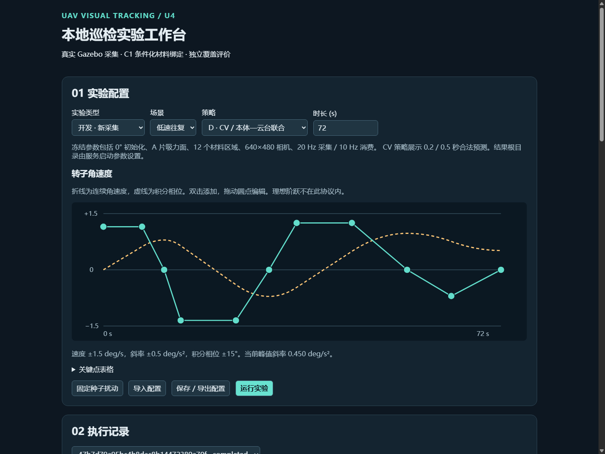
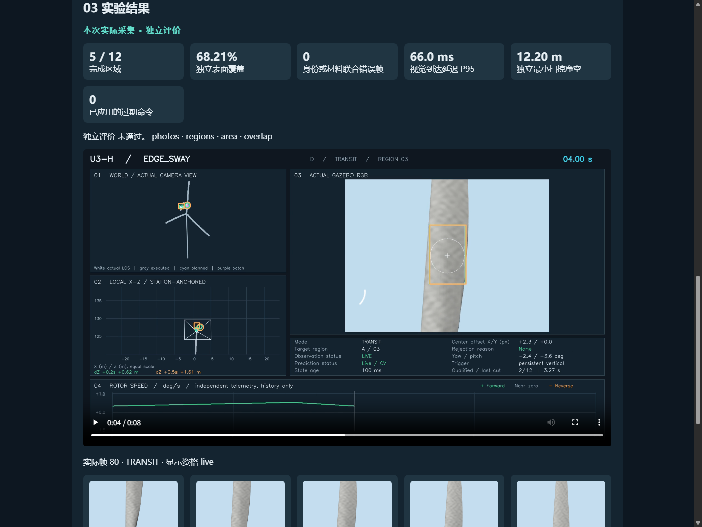

# 本地巡检工作台技术指南

安装入口、启动命令与研究边界见[项目 README](../../README.md)。

## 复现层级

| 层级 | 验证方法 | 资产要求 |
|---|---|---|
| 1 · 源码 | 运行 README 的单元测试和 npm 构建 | Git 仓库与软件依赖 |
| 2 · 配置 | 启动服务，导入开发示例，编辑曲线并保存 | 无需 Gazebo 或研究归档 |
| 3 · 冻结回放 | 选「冻结历史 · 回放」，分别运行往复 D 和减速 D | U3-G 冻结记录与评价参考网格 |
| 4 · 新采集 | 运行 README 的 8 秒开发配置，检查实测曲线、RGB 样本与覆盖 | Gazebo、插件、C1 配置及场景资产 |

第 3、4 层使用有访问权限的既有研究归档。通过研究资产维护者获取匹配的冻结目录。设置 `UAV_WORKBENCH_ARCHIVE` 指向归档根，默认是仓库根下的 `.local/research_archive`。新采集根据 `stage_u3g_joint_uav_gimbal_01/formal/LOCK.json` 核验策略的 `consumer_spec.json`、`local.sdf` 与 `config_snapshot.yaml`。SDF 引用网格和纹理，独立评价还读取 `simulator_migration/reference_model`。回放从同一 `formal` 树读取原始帧、相机状态与回执，重算关键指标并与冻结评价比较。

## Gazebo 环境与插件

Ubuntu 24.04 或 WSL2 使用 ROS 2 Jazzy 与 Gazebo Harmonic 的系统软件包。准备 Gazebo Transport 13、Msgs 10 的 Python 绑定和 Ogre2，构建需要 CMake、C++17 工具链及 gz-sim8、gz-plugin2 的开发组件。WSL2 需要可用的 WSL 图形支持和宿主机驱动。使用 Ubuntu 系统 Python 来匹配系统绑定：

```bash
source /opt/ros/jazzy/setup.bash
/usr/bin/python3 -c 'import cv2, numpy, yaml, gz.transport13, gz.msgs10.image_pb2'
gz sim --versions
ffmpeg -hide_banner -encoders | grep libx264
cmake -S sim/workbench -B .local/workbench-plugin
cmake --build .local/workbench-plugin
```

在 Ubuntu 系统环境中补齐 `python3-opencv`、`python3-numpy` 和 `python3-yaml`。编码可使用 Ubuntu 的 `ffmpeg` 软件包，或通过 `--ffmpeg` 指定经过上方命令核验的 Linux 编码器。独立工作台 Python 环境可使用 Conda 或 venv。Gazebo 绑定由 `--linux-python` 选定的运行环境加载，默认 `python3`。推荐明确传入 `/usr/bin/python3`。在原生 Ubuntu 启动服务前加载 ROS 环境。Windows 后端在 WSL 内加载 ROS 环境，并用 `wslpath` 转换路径。仓库、归档和结果目录均须对 WSL 可读写或按用途可读。

默认加载本地归档中已构建的插件。使用新构建的插件时，给 `serve` 或 `run` 加上 `--plugin .local/workbench-plugin/libU3Motion.so`。需要替换 FFmpeg 时使用 `--ffmpeg`。其他选项见 `uav-workbench --help`。

## 参数、数据流与结果

`omega_points_deg_s` 从时间 0 严格递增，末点时间等于运行时长。角速度按段线性插值，角度逐段解析积分。开发配置范围为 8–72 s、±1.5 deg/s、±0.5 deg/s²、积分相位 ±15°。正式运行和历史回放使用冻结曲线。C1 登记锁定初相位、相机内参、叶片面与拍摄区域。

```text
Web / CLI → 参数校验、唯一 ID、配置快照
             ├ 新采集 → Gazebo 20 Hz RGB → 10 Hz 视觉 → 规划与执行回执
             └ 冻结回放 → 读取真实历史 RGB、遥测与回执
                                  ↓
                      独立评价 → 因果视频渲染
```

实际帧、估计、预测、规划参考和独立 GT 各自记录。渲染以模拟时钟、到达时钟、命令发布和实际应用回执判断显示资格。`status.json` 与 `task.log` 记录状态及错误。`result.json`、`SUMMARY.json` 与 `surface_ledger.npz` 保存评价，`trajectory.csv`、`action_alignment.json` 及 `demo.frames.json` 支持逐帧核对。新采集另有 `recording/` 与 `motion_verification.json`。任务失败或取消保留已有证据。

如果 WSL 的 Ogre2 在默认显卡上崩溃，可在 Ubuntu 内通过 `MESA_D3D12_DEFAULT_ADAPTER_NAME` 选择本机已验证的适配器。Windows 宿主机启动服务时，可通过 WSLENV 将此设置传入 WSL：

```powershell
$env:MESA_D3D12_DEFAULT_ADAPTER_NAME = "NVIDIA"  # 示例。使用本机适配器名称。
$env:WSLENV = (@($env:WSLENV, "MESA_D3D12_DEFAULT_ADAPTER_NAME") | Where-Object { $_ }) -join ":"
```

如果无法预览，确认服务与前端构建来自同一版本。如果新采集在准备阶段失败，检查 WSL 路径、C1 输入锁与插件。Gazebo 启动失败时查看运行日志，确认 Ogre2 和图像传输。编码失败时检查 FFmpeg 编码器和结果盘空间。

## 复核记录

- 冻结往复 D 为 12/12，减速 D 为 11/12。往复 D 的 403 条逐帧回执与冻结显示证据一致。
- 浏览器提交的 8 秒开发曲线采集 161 张 RGB，独立评价为 5/12、覆盖 68.21%。实测关节相位与解析积分最大偏差 0.0003°，三张抽样 RGB 的哈希均与冻结记录不同。
- Windows Conda 的 Python 3.12、Node 22 和 libx264 已验证。25 项公开基线和 10 项工作台测试在无研究归档配置下通过。36 项历史契约另用本地研究归档验证。
- Ubuntu 24.04 内直接启动 Linux CLI 并使用系统 Python 3.12 和重新构建的插件，完成新采集、评价和 1080p 编码。此验证运行于 WSL2 的 Ubuntu 环境。Windows Conda 调度路径也完成了新采集与编码。两条启动路径均采集 161 张 RGB，分别独立完成 5/12 和 4/12。新采集受实时观测和执行时序影响，冻结回放用于复核既有指标。

以下截图保留对应实测时的界面和数据。




